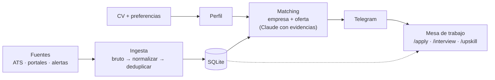

# job-radar

Radar personal de empleo **guiado por el CV**. Extrae del CV las competencias, las cruza con las preferencias de la persona (ubicación, modalidad, roles) y vigila **fuentes de calidad**:
- los ATS de las propias empresas,
- InfoJobs, Indeed y LinkedIn,
- portales de remoto.

Puntúa empresas y ofertas con Claude y avisa por Telegram solo de lo que merece la pena.

Tiene dos caras sobre los mismos datos:
- **El motor**, automático: corre solo y avisa.
- **La mesa de trabajo**, interactiva: Claude Code con los comandos de [ai-job-search](https://github.com/MadsLorentzen/ai-job-search) integrados, para preparar candidaturas y entrevistas y analizar qué skills faltan.

Pensado para correr en una Raspberry Pi 5. Primer caso de uso: un AI/LLM Engineer que busca trabajo en Málaga o en remoto desde España.

> **Estado:** fase 2 (perfil desde el CV). Roadmap en el [tablero del proyecto](https://github.com/users/rubenhig/projects/1) y en [Milestones](../../milestones) (una por fase). Arquitectura en [`docs/arquitectura.md`](docs/arquitectura.md); entidades y conectores de fuentes en [`docs/modelo.md`](docs/modelo.md).



## Roadmap

| Fase | Estado |
|---|---|
| 0 · Exploración y estado del arte | ✅ |
| 1 · Fuentes | ✅ |
| 2 · Perfil desde el CV | 🔄 en curso |
| 3 · Ingesta | ⬜ |
| 4 · Puntuación | ⬜ |
| 5 · Avisos → **MVP** | ⬜ |
| 6 · Raspberry Pi | ⬜ |
| 7 · Empresas | ⬜ |
| 8 · Mesa de trabajo (`/upskill` tras la ingesta; `/apply`, `/interview`, `/outcome` tras el MVP) | ⬜ |
| 9 · Vivienda | ⬜ |

## Principios

- **Las fuentes de calidad primero.** La ingesta es la parte más cuidada.
- **Integrar, no crear.** Cada bloque usa una herramienta open source existente que ha pasado una prueba verificable. Por ejemplo, [JobSpy](https://github.com/speedyapply/JobSpy) y [ats-scrapers](https://github.com/kalil0321/ats-scrapers).
- **Poco a poco.** Cada fase termina con algo comprobable.

## Pruebas de fuentes

```sh
uv run spikes/fuentes_empleo.py   # JobSpy + Tecnoempleo + ATS detectados → data/spike/*.csv
uv run spikes/analisis.py         # resumen por fuente
uv run spikes/prueba_ats.py       # ATS de empresas (Greenhouse, Workday, Teamtailor)
uv run spikes/prueba_infojobs.py  # InfoJobs con búsquedas acotadas
```

## Perfil

```sh
uv run python -m job_radar.perfil --cv ruta/al/cv.pdf   # competencias con evidencias → data/perfil/perfil_cv.yaml
uv run pytest                                           # tests
```

Las preferencias (ubicación, modalidad, roles…) se configuran copiando `config/preferencias.ejemplo.yaml` a `data/perfil/preferencias.yaml`.

Los datos personales y los resultados (`data/`, `.env`) nunca entran en el repositorio.
