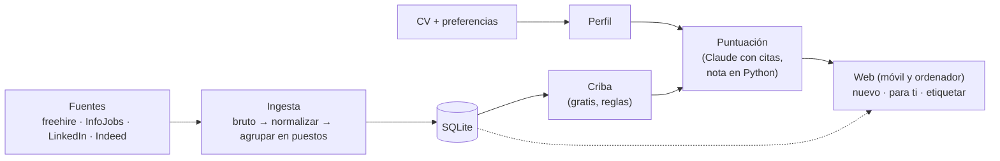

# job-radar

Radar personal de empleo **guiado por el CV**. Extrae del CV las competencias, las cruza con las preferencias de la persona (ubicación, modalidad, roles, salario) y vigila **fuentes de calidad**:
- freehire, un agregador abierto de ATS de empresas y portales (también el remoto),
- InfoJobs, LinkedIn (vía la API de fantastic.jobs en Apify) e Indeed,
- más adelante, los ATS de las empresas que se vigilen (Fase 7).

Agrupa las ofertas en puestos, descarta sin coste lo que no encaja y puntúa el resto con Claude. Lo nuevo y lo mejor puntuado se mira en la web.

Tiene un núcleo y varias formas de usarlo, todas sobre los mismos datos:
- **El motor**, automático: ingesta y puntuación diarias.
- **La web**, la puerta principal: todo el sistema desde el móvil y el ordenador.
- **La mesa de trabajo**: los comandos de [ai-job-search](https://github.com/MadsLorentzen/ai-job-search) integrados, para preparar candidaturas y entrevistas y analizar qué skills faltan; se lanzarán desde la web o desde Claude Code.
- **Telegram**, para avisar al momento: aparcado hasta la búsqueda activa (~primavera de 2027).

Pensado para correr en una Raspberry Pi 5. Primer caso de uso: un AI/LLM Engineer que busca trabajo en Málaga o en remoto desde España.

> **Estado (18-oct-2026):** la ingesta funciona y está en su semana de prueba con launchd hasta el 23-oct (#39); la puntuación corre a diario y coincide en ≈90 % con las etiquetas de Rubén. Siguiente fase: la Raspberry Pi. Roadmap en el [tablero del proyecto](https://github.com/users/rubenhig/projects/1) y en [Milestones](../../milestones) (una por fase). Arquitectura en [`docs/arquitectura.md`](docs/arquitectura.md); entidades, conectores, criba y puntuación en [`docs/modelo.md`](docs/modelo.md).



## Roadmap

| Fase | Estado |
|---|---|
| 0 · Exploración y estado del arte | ✅ |
| 1 · Fuentes | ✅ |
| 2 · Perfil desde el CV | ✅ |
| 3 · Ingesta | 🔄 semana de prueba hasta el 23-oct (#39) |
| 4 · Puntuación + base de la web → **MVP** | 🔄 falta el motor en Docker y el coste diario (#44) |
| 5 · Avisos (Telegram) | ⏸️ aparcada hasta la búsqueda activa |
| 6 · Raspberry Pi | ⬜ siguiente |
| 7 · Empresas | ⬜ |
| 8 · Mesa de trabajo (`/upskill` tras la ingesta; `/apply`, `/interview`, `/outcome` tras el MVP) | ⬜ |
| 9 · Vivienda | ⬜ |

## Principios

- **Las fuentes de calidad primero.** La ingesta es la parte más cuidada.
- **Integrar, no crear.** Cada bloque usa una herramienta open source existente que ha pasado una prueba verificable. Por ejemplo, [JobSpy](https://github.com/speedyapply/JobSpy) y [ats-scrapers](https://github.com/kalil0321/ats-scrapers).
- **Poco a poco.** Cada fase termina con algo comprobable.

## Web

```sh
uv run uvicorn job_radar.api:crear --factory --reload   # API en http://127.0.0.1:8000 (docs en /api/docs)
cd web && npm install && npm run dev                     # web en desarrollo, en http://localhost:5173
docker compose up -d --build                             # o todo junto, como irá en la Pi, en http://127.0.0.1:8000
```

Pantallas: inicio (lo nuevo desde tu última visita y lo mejor puntuado), puestos (con los descartados aparte), ficha de puesto, etiquetar, puntuación, fuentes y perfil. Ver [`web/`](web/README.md).

Notas de Docker:
- Una sola imagen (Node compila la web; Python con uv sirve la web y la API). Corre como uid 1000, en hora de Madrid, con healthcheck en `/api/vivo`.
- `data/` es un volumen y las claves van en `.env` (plantilla: [`.env.ejemplo`](.env.ejemplo)), nunca en la imagen.
- En el Mac, **no mezclar procesos dentro y fuera de Docker** sobre la misma base: SQLite en modo WAL no comparte memoria entre el Mac y la máquina virtual de Docker. O todo dentro o todo fuera: mientras la ingesta corra con launchd (fuera de Docker), la API también va fuera, con uv.

## Ingesta

```sh
uv run job-radar ingesta                    # lanza las búsquedas que tocan según su frecuencia (config/fuentes.yaml)
uv run job-radar ingesta --todas            # todas, toque o no (cuidado con InfoJobs y el gasto de LinkedIn)
uv run job-radar ingesta --fuente freehire  # solo una fuente (se puede repetir)
uv run job-radar ingesta --puntuar          # y después puntúa lo nuevo (--limite-puntuar N, 150 por defecto)
uv run job-radar resumen                    # ofertas y puestos por fuente, exclusividad y salud
uv run job-radar salud                      # alertas de las fuentes; sale con 1 si hay alguna
uv run job-radar copia                      # copia de seguridad de la base
uv run job-radar renormalizar               # reinterpreta lo guardado desde el bruto con los conectores actuales
uv run datasette data/job_radar.db --metadata config/datasette.yaml   # panel: fuentes, ejecuciones, puestos, trazas
```

- Las fuentes y su conector se declaran en `config/fuentes.yaml`; las búsquedas salen de las preferencias. Los mercados en remoto de `remoto.mercados` (p. ej. AE, SA, QA) solo los buscan las fuentes con `mercados: true` (freehire, gratis).
- Cada búsqueda pide desde su última ejecución buena (la ventana queda en `ejecucion.ventana_h`): un día que falla se recupera al siguiente. Un cerrojo impide dos ingestas a la vez, y una ejecución que se queda colgada pasa a error.
- Las claves van en `.env` (`APIFY_TOKEN` para LinkedIn; `RAPIDAPI_KEY` como plan B; `HEALTHCHECKS_URL`, opcional). Plantilla: [`.env.ejemplo`](.env.ejemplo).
- En el Mac corre a diario a las 8:30 con launchd, y también puntúa (gasta suscripción de Claude): ver [`deploy/launchd/`](deploy/launchd/com.rubenhig.job-radar.plist).
- Cada ingesta empieza con una copia de la base en `data/copias/` (7 diarias y 4 de lunes). El log está en `data/logs/ingesta.log` (rota cada día, 30 días). Con `HEALTHCHECKS_URL`, avisa a Healthchecks al empezar y, tras puntuar, de si todo fue bien o falló.

## Puntuación

```sh
uv run job-radar cribar        # recalcula los descartes sin coste (tras cambiar las preferencias)
uv run job-radar puntuar       # puntúa lo que pasa la criba y no tiene nota, o cuyo texto cambió (lo más nuevo primero)
uv run job-radar recalcular    # rehace la nota sin llamar al modelo (p. ej. tras cambiar el salario)
uv run job-radar medir         # acuerdo de la puntuación con tus etiquetas (--rubrica para otra versión)
```

- `puntuar` admite `--etiquetados` (solo lo etiquetado, para medir), `--rehacer`, `--modelo` (sonnet por defecto), `--paralelo` y `--limite`.
- Claude (`claude -p` con la suscripción) da veredictos con citas literales; Python comprueba las citas y calcula la nota con pesos fijos. Detalle en [`docs/modelo.md`](docs/modelo.md#puntuación).
- `ANTHROPIC_API_KEY` no debe estar definida: con ella, `claude -p` cobraría por token en vez de usar la suscripción (el conector la quita del entorno por si acaso).

## Pruebas de fuentes (Fase 1)

```sh
uv run spikes/fuentes_empleo.py   # JobSpy + Tecnoempleo + ATS detectados → data/spike/*.csv
uv run spikes/analisis.py         # resumen por fuente
uv run spikes/prueba_ats.py       # ATS de empresas (Greenhouse, Workday, Teamtailor)
uv run spikes/prueba_infojobs.py  # InfoJobs con búsquedas acotadas
```

## Perfil

```sh
uv run python -m job_radar.perfil --cv ruta/al/cv.pdf   # competencias con evidencias → data/perfil/perfil_cv.yaml
uv run pytest                                           # tests
```

Las preferencias (ubicación, modalidad, roles…) se configuran copiando `config/preferencias.ejemplo.yaml` a `data/perfil/preferencias.yaml`.

Los datos personales y los resultados (`data/`, `.env`) nunca entran en el repositorio.
