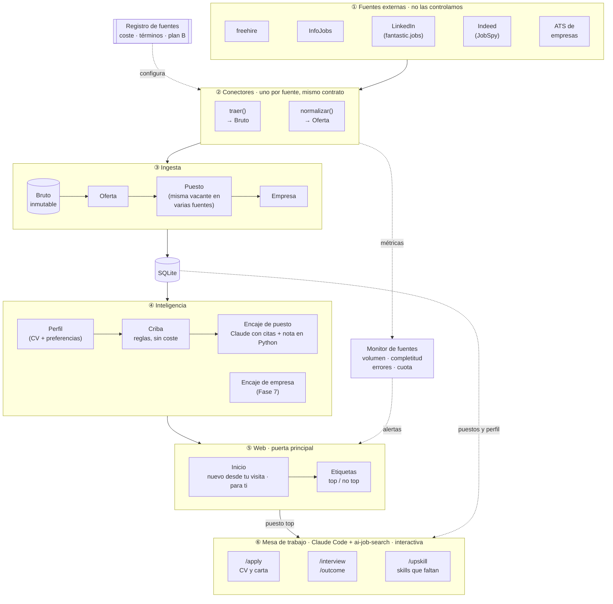
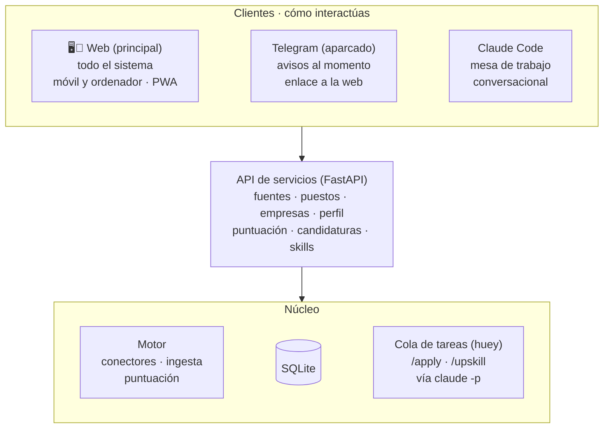
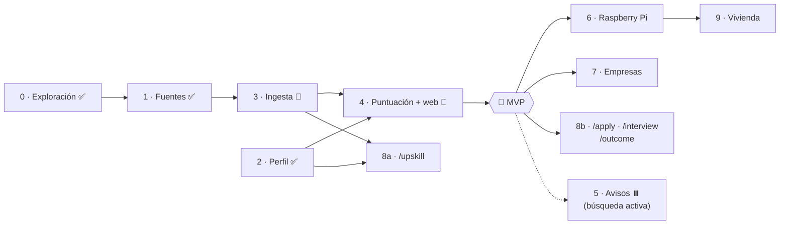

# job-radar: arquitectura, roadmap y fuentes

## Objetivo

Un radar personal de empleo **guiado por el CV**. A partir del CV y de las preferencias de la persona, encuentra las empresas y las ofertas que encajan con ella, las puntúa y las muestra en la web: lo nuevo desde la última visita y lo mejor puntuado.

El sistema tiene un **núcleo** y varias formas de usarlo:
- **El motor (automático):** un servicio en Python que corre solo (hoy en el Mac con launchd; en la Fase 6, en la Raspberry Pi). Encuentra, agrupa, criba y puntúa.
- **La mesa de trabajo:** los comandos de [ai-job-search](https://github.com/MadsLorentzen/ai-job-search) (MIT) integrados, sobre los puestos y el perfil del motor: preparar candidaturas (`/apply`), entrevistas (`/interview`), seguimiento (`/outcome`) y análisis de skills que faltan (`/upskill`).
- **La web (puerta principal):** desde el móvil y el ordenador se maneja **todo el sistema**, incluida la mesa de trabajo. Claude Code queda para trabajar de forma conversacional. Telegram, para avisar al momento, está **aparcado** (decisión del 18-oct): no es el MVP y se retomará con la búsqueda activa (~primavera de 2027).

Todo lo que depende de la persona es **configuración del perfil**, no código:
- ubicaciones (p. ej. Málaga)
- modalidades (presencial, híbrido, remoto desde España, remoto con empresa extranjera)
- roles e idiomas
- salario actual y objetivo
- términos de la criba (qué títulos se descartan sin puntuar)

El primer usuario es Rubén: AI/LLM Engineer y agentes en producción, en Málaga o en remoto desde España. Si funciona, más adelante se convierte en producto. La vivienda es un **módulo secundario** que reutiliza la misma plataforma.

Principios:
1. **La calidad depende de las fuentes.** La ingesta es la parte más cuidada.
2. **Integrar, no crear.** Para cada bloque se usa una herramienta existente que haya pasado una prueba verificable. El código propio es solo el pegamento, más lo que no exista. Catálogo de candidatos: [`docs/repositorios.md`](repositorios.md).
3. **La empresa es la unidad principal**, no la oferta (ver `docs/estado-del-arte.md`).
4. **Poco a poco.** Cada fase termina con algo comprobable.
5. **Un solo perfil, una sola base de datos y una sola capa de servicios.** La web, la terminal y Claude Code (y Telegram, si llega) usan las mismas funciones sobre los mismos datos; nada se programa ni se mantiene dos veces.

## Arquitectura

Tres bucles que no se dibujan para que el diagrama se lea de arriba abajo:
- **Etiquetas → Inteligencia:** tus etiquetas top / no top (pantalla Etiquetar) son la vara con la que se mide y ajusta la puntuación (`job-radar medir`).
- **Candidaturas → Inteligencia:** lo que registra `/outcome` (entrevista, rechazo, oferta) es la etiqueta más valiosa de todas, y volverá al SQLite como etiqueta.
- **Encaje de empresa → Registro de fuentes:** las empresas que más encajan pasan a vigilarse, y su ATS se añade como búsqueda de la fuente `ats`.

Transversal a todo: **planificador** (launchd en el Mac durante la prueba; en la Pi, huey en el `worker`, #41), **configuración** (perfil y fuentes), **tope de gasto en LLM** y **Datasette** sobre el SQLite como herramienta de depuración.

### Cómo se interactúa

- **API de servicios en el centro.** Cada acción del sistema (lanzar una fuente, puntuar, dar feedback, editar preferencias, preparar una candidatura…) es una función de Python expuesta por una API (FastAPI). La web y la terminal son clientes (y Telegram, si llega): añadir una pantalla es dibujar lo que ya existe.
- **Web: la puerta principal.** Todo el sistema, desde el móvil y el ordenador. Una app moderna y cuidada: React + shadcn/ui sobre la plantilla shadcn-admin, con gráficos y modo oscuro, instalable en el móvil (PWA); ver [repositorios](repositorios.md#bloque-interfaz-web). Se compila en el Mac o en CI. En la Pi, FastAPI sirve la app y la API desde el mismo origen, con HTTPS de `tailscale serve`: **la Pi no limita el diseño**.
- **La mesa de trabajo, también desde la web.** "Preparar candidatura" o "Analizar skills" lanzan los comandos de ai-job-search por detrás con `claude -p`. Como tardan minutos, van a una **cola de tareas** (huey sobre SQLite) y el resultado aparece en la web para revisarlo.
- **Telegram, aparcado.** Avisaría al momento con un enlace a la ficha del puesto en la web. Hasta la búsqueda activa (~primavera de 2027), la web con lo nuevo desde la última visita basta.
- **Acceso privado con Tailscale:** la web vive en la Pi y solo se ve desde tus dispositivos, sin exponer nada a internet ni gestionar contraseñas mientras haya un único usuario.
- **Despliegue con Docker Compose**, igual en el Mac y en la Pi. Hay dos servicios:
  - `api`: FastAPI, que sirve la web compilada y la API. La imagen se construye en dos etapas: Node compila la web y luego se monta Python con uv.
  - `worker` (Fase 6, #41): huey, que lanzará la ingesta según su frecuencia, la puntuación y las tareas largas; sustituye a launchd. Hasta entonces, en el Mac solo está `api` y la ingesta corre con launchd fuera de Docker.

  Los dos comparten un volumen con `data/` (SQLite y perfil); las claves van en `.env`, nunca en la imagen. Fuera de Docker quedan el desarrollo diario (uv y el servidor de Vite), Tailscale (en el sistema de la Pi) y la mesa de trabajo interactiva (Claude Code). Pendiente de decidir en la Fase 6 (#44): cómo puntúa Claude dentro del `worker`, con `claude -p` y un token de la suscripción (`CLAUDE_CODE_OAUTH_TOKEN`, de `claude setup-token`) o con una clave de API.

  Operación: la imagen corre como uid 1000, en hora de Madrid y con healthcheck en `/api/vivo`; SQLite espera hasta 15 s si la base está ocupada (`busy_timeout`). En el Mac no se mezclan procesos dentro y fuera de Docker sobre la misma base (WAL).

**Funcionalidades de la web, por fases:**

| Sección | Qué se hace | Fase | Estado |
|---|---|---|---|
| Inicio | «Desde tu última visita» (las visitas se guardan en el servidor), «Para ti» (nota 50 o más) y «¿Piensa como tú?» (acuerdo con tus etiquetas) | 4 | ✅ |
| Puestos | Lista ordenada por nota, con filtros (fuente, modalidad, ciudad, etiqueta, nota, fecha), búsqueda, «Solo nuevos» y los descartados por la criba aparte | 4 (#30) | ✅ |
| Ficha de puesto | Sus ofertas, campos fusionados con su procedencia, enlaces a la original; la nota explicada, con las citas resaltadas en la descripción | 4 | ✅ |
| Etiquetar | Top / no top con motivo, rápido desde el móvil, sin ver la nota (a propósito): la vara de medir de la puntuación | 4 (#30) | ✅ |
| Perfil y preferencias | Competencias con sus citas; editar ubicaciones, mercados en remoto, roles, términos de la criba, inglés y salario. Volver a extraer el perfil desde un CV: pendiente | 4 (#30) | ✅ |
| Puntuación | Acuerdo con las etiquetas (también dejando uno fuera y κ de Cohen) y caso a caso; coste: pendiente (#44) | 4 | ✅ |
| Fuentes | Salud, ejecuciones, cuota y gasto; exclusividad, lanzar a mano y pausar: pendiente (sustituye a Datasette) | 4–6 | 🔄 |
| Avisos | Historial, umbral y frecuencia del resumen | 5 | ⏸️ |
| Empresas | Descubiertas, puntuación, seguidas y sus ofertas | 7 | ⬜ |
| Candidaturas | Kanban, preparar CV y carta, entrevistas, resultados | 8 | ⬜ |
| Skills | Qué piden los puestos y te falta; qué estudiar | 8 | ⬜ |
| Vivienda | Pisos | 9 | ⬜ |

En todas: modo oscuro e instalable en el móvil (PWA que se recarga sola al desplegar una versión nueva); más adelante, progreso de las tareas largas.

| Pieza | Responsabilidad | Detalle |
|---|---|---|
| **Conectores** | Aislar cada fuente externa tras un contrato único (`traer` + `normalizar`). Lo único que cambia si cambia una fuente | [`docs/modelo.md`](modelo.md#el-conector-contrato-de-cada-fuente) |
| **Registro de fuentes** | Qué fuentes hay, con qué herramienta, a qué coste, con qué términos y cuál es su plan B | [`docs/modelo.md`](modelo.md#el-conector-contrato-de-cada-fuente) |
| **Ingesta** | Guardar el bruto, normalizar a `Oferta`, agrupar ofertas en `Puesto` (mismo puesto en varias fuentes o consultoras) y resolver la `Empresa` | [`docs/modelo.md`](modelo.md#entidades) |
| **Monitor de fuentes** | Detectar caídas, cambios de formato silenciosos, falta de cuota y fuentes que dejan de aportar | [`docs/modelo.md`](modelo.md#monitorización) |
| **Perfil** | CV → competencias con evidencia; preferencias configurables (ubicación, modalidad, roles, idiomas) | Fase 2 |
| **Inteligencia** | Criba sin coste, encaje de puesto (Claude con citas, nota en Python) y, más adelante, encaje de empresa | Fase 4 ([`docs/modelo.md`](modelo.md#criba-y-puntuación)); empresa, Fase 7 |
| **Avisos** | Aviso inmediato de lo top y resumen semanal por Telegram | Fase 5, aparcada |
| **Mesa de trabajo** | Comandos de ai-job-search en Claude Code, adaptados para leer el perfil y los puestos del SQLite: `/apply` (CV adaptado y carta con agente revisor), `/interview`, `/outcome` y `/upskill`. Su `/scrape` y su `/setup` no se usan: los sustituyen el motor y nuestro perfil | Fase 8 |
| **API de servicios** | Todas las acciones del sistema como funciones con nombre, expuestas por FastAPI; la usan la web y la terminal | Fase 4 (base) y siguientes |
| **Web** | Interfaz principal para todo el sistema, en móvil y ordenador | Una pantalla por fase, desde la Fase 4 |
| **Cola de tareas** | Servicio `worker` (huey): ingesta según frecuencia, puntuación, comandos de la mesa de trabajo y fuentes a demanda | Fase 6 (#41) |
| **SQLite** | Única fuente de verdad: bruto, ofertas, puestos, empresas, etiquetas, evaluaciones, ejecuciones (y más adelante avisos y candidaturas). Copia diaria en `data/copias/` | Fase 3 |

Los nombres de entidades (Fuente, Búsqueda, Ejecución, Bruto, Oferta, Puesto, Empresa, Perfil, Etiqueta, Evaluación, Aviso, Feedback, Candidatura) y los campos comunes de una oferta están en [`docs/modelo.md`](modelo.md).

### Matching a dos niveles
- **Empresa** (¿es una empresa para mí?): a qué se dedica, madurez en IA con evidencias, stack, presencia en las ubicaciones del perfil o remoto, momento de contratación. Se recalcula de forma mensual o cuando cambia el perfil. Decide qué empresas se vigilan y con qué frecuencia.
- **Puesto** (¿es este puesto para mí?), en marcha desde la Fase 4:
  - Primero, la **criba**: reglas deterministas y sin coste (país, títulos excluidos, títulos no técnicos).
  - Después, Claude da veredictos por criterio, con valores cerrados y una cita literal de la oferta. Las compuertas (modalidad, elegibilidad, idioma) son pasa / no pasa / marca / sin datos.
  - Python comprueba las citas y calcula la nota con pesos fijos y el salario. Detalle de la rúbrica vigente (`rubrica/2`) en [`docs/modelo.md`](modelo.md#criba-y-puntuación).
  - Cuando exista el nivel empresa (Fase 7), su encaje ponderará la nota del puesto.

### Fuentes v1
Validadas por Rubén el 16-oct-2026, con datos de las pruebas y del [solapamiento en Málaga](#fase-1--fuentes-pruebas).

| Fuente | Herramienta | Aporta | Frecuencia | Coste |
|---|---|---|---|---|
| **freehire** | API pública (MIT) | Amplitud: ATS de empresas y remoto; 72 % de exclusivas en Málaga | Diaria | Gratis |
| **InfoJobs** | `infojobs_es` de ats-scrapers + httpcloak, búsquedas acotadas | Mercado español y **salario (~55 %)**; 95 % de exclusivas | Diaria | Gratis |
| **LinkedIn** | Actor de fantastic.jobs en Apify (#40); la misma API en RapidAPI, de plan B | **Más ofertas de IA exclusivas**, ficha de empresa, modalidad y skills | Diaria (remoto, semanal) | ~4,4 $/mes (tope 4,8 $; plan gratuito de Apify, 5 $) |
| **Indeed** | JobSpy | Complemento; 29 % de exclusivas | Cada 2–3 días | Gratis |
| **ATS de empresas** | ats-scrapers (+ envolturas de Workday y Teamtailor) | La fuente original, para las empresas que vigilemos | Diaria (Fase 7) | Gratis |

Remoto en otros mercados: los países de `remoto.mercados` (p. ej. AE, SA, QA) solo se buscan en las fuentes gratuitas con `mercados: true` (hoy, freehire).

Aparcado: Tecnoempleo (#8). Descartados: emails de alerta (#9, #10, 18-oct). Fuera: Glassdoor, Google Jobs, LinkedIn con sesión y auto-apply.

## Roadmap

El seguimiento vivo está en GitHub: cada fase es un **milestone** y cada tarea un **issue** con sus criterios de aceptación y sus dependencias.

| # | Fase | Qué conseguimos | Criterios de aceptación | Herramientas a probar |
|---|---|---|---|---|
| 0 | Exploración ✅ | Datos reales de varias fuentes | `spikes/` con datos de 4 fuentes | — |
| 0b | Estado del arte ✅ | Saber qué existe | `docs/estado-del-arte.md` | — |
| 1 | Fuentes ✅ | Saber de dónde salen las ofertas | Cada fuente candidata probada y marcada como ✅ o ❌. Lista de fuentes v1 cerrada. Campos comunes de una oferta definidos | ver tabla de abajo |
| 2 | Perfil ✅ | El CV convertido en perfil | Fichero de perfil (competencias con evidencia + preferencias) extraído con Claude y **aprobado por Rubén**. Ubicaciones y modalidades son configurables. *Pantalla de perfil y preferencias: llega con la base de la web (Fase 4).* | `claude -p` con la suscripción (conector LLM reemplazable); `pypdf`; ESCO + JobBERT-v3 (#14), con propuesta de aplazarlo a la Fase 4 |
| **3** | **Ingesta** 🔄 *semana de prueba hasta el 23-oct (#39)* | Ofertas guardadas sin duplicados | Un comando llena SQLite con las fuentes v1 a través de conectores con el mismo contrato (bruto + normalizado). La misma vacante en varias fuentes o consultoras es un solo Puesto. Métricas por fuente. 7 días seguidos sin errores en el Mac. **Datasette** para ver fuentes, ejecuciones, ofertas y puestos. *Hecho: las cuatro fuentes, ventanas desde la última ejecución buena, cerrojo, ciclo de vida de ofertas y puestos, copias y logs rotados* | `sqlite-utils`, `tenacity`, `rapidfuzz` + `cleanco`, Healthchecks, Datasette |
| **4** | **Puntuación + base de la web** 🔄 *falta el coste diario (#44)* | Claude decide qué es top, y se ve en la web | 30 ofertas etiquetadas por Rubén. Claude coincide en al menos un 80 % (top / no top). Coste diario medido. **Base de la web** (API de servicios + app) con las primeras pantallas: **etiquetar ofertas**, fichas de puesto con puntuación y citas, y perfil. *Hecho: criba, rúbrica v2 con ≈90 % de acuerdo y ningún top perdido, puntuación diaria tras la ingesta y la web con sus pantallas* | Criba propia; rúbrica propia (`rubrica/2`) sobre las de career-ops y ai-job-search (compuertas + 5 dimensiones con valores cerrados y citas verificadas); `claude -p` con Sonnet y la suscripción; `job-radar medir` (acuerdo, dejando uno fuera, κ de Cohen) |
| 🎯 | **MVP** | **Radar útil de punta a punta** | Ingesta y puntuación diarias, y la web con lo nuevo desde la última visita y lo mejor puntuado, mirada a diario | |
| 5 | Avisos ⏸️ *aparcada hasta la búsqueda activa (~primavera de 2027)* | Llega a Telegram | Aviso inmediato de lo top y resumen semanal, recibidos durante una semana. Cada aviso enlaza a su ficha en la web; **bandeja de avisos** en la web | aiogram 3 (modelo: JobNavigator); Apprise |
| 6 | Raspberry Pi ← *siguiente* | Funciona sola | El mismo `docker compose` del Mac (`api` + `worker`), 7 días en la Pi. Alerta si una fuente cae a 0. **Web accesible por Tailscale** desde el móvil y el ordenador, instalable como app. Decidir el motor de la puntuación dentro de Docker (#44) | Docker Compose (imágenes arm64); `tailscale serve`; huey como planificador (#41) |
| 7 | Empresas | Encaje a nivel empresa | Lista viva de empresas puntuadas. Las mejores se vigilan solas. **Pantalla de empresas** (encaje, vigiladas, descartadas) | Empresas con ATS en freehire, ficha de LinkedIn, `discover` de maccydee/job-radar, PDF del PTA |
| 8a | Mesa de trabajo: `/upskill` | Saber qué skills faltan para los puestos objetivo | `/upskill` de ai-job-search ejecutado sobre los puestos del SQLite y nuestro perfil; plan de aprendizaje revisado por Rubén, visible en la web. Puede hacerse en cuanto haya ingesta (Fase 3) | ai-job-search (MIT) |
| 8b | Mesa de trabajo: candidaturas | Presentarse a un puesto top con buen material | `/apply`, `/interview` y `/outcome` funcionan sobre un Puesto del SQLite y el perfil exportado; los resultados de `/outcome` vuelven como feedback. **Tablero de candidaturas** y botón "Preparar candidatura" en la web (cola de tareas) | ai-job-search (MIT); exportar `perfil_cv.yaml` → su `01-candidate-profile.md` |
| 9 | Vivienda | Módulo secundario | Por definir al llegar | — |

## Fase 1 · Fuentes: pruebas

Estados: ⬜ por probar · 🟡 probada a medias · ✅ aprobada · ❌ descartada · ⏸️ aparcada · ➡️ movida a otra fase.

| Fuente | Herramienta | Prueba verificable | Estado |
|---|---|---|---|
| ATS de empresas | [`ats-scrapers`](https://github.com/kalil0321/ats-scrapers) 0.3.0 (MIT) con `beautifulsoup4`, `html2text` y `aiohttp` | Leer las ofertas de Ebury (Greenhouse EU), Freepik (Teamtailor) y Accenture Málaga (Workday) → `spikes/prueba_ats.py` | ✅ 15-oct-2026, detalle abajo |
| InfoJobs | Adaptador `infojobs_es` de ats-scrapers + `httpcloak`, con `listing_url` filtrado y `max_pages` bajo | Página 1 sin captcha, filtro respetado, descripción y modalidad rellenas → `spikes/prueba_infojobs.py` | ✅ 15-oct-2026, detalle abajo |
| Indeed y Glassdoor | [JobSpy](https://github.com/speedyapply/JobSpy) `python-jobspy==1.3.0` (MIT) | Ofertas de la ubicación con descripción y URL directa | ✅ Indeed como fuente secundaria (29 % de exclusivas en Málaga); ❌ Glassdoor fuera |
| LinkedIn (búsqueda) | **API de LinkedIn de fantastic.jobs vía RapidAPI** (v4, `/active-jb`); plan B: JobSpy con pausas | Ofertas de Málaga y remoto con descripción → `spikes/prueba_linkedin_api.py` | ✅ 16-oct-2026, detalle abajo; en producción, el mismo proveedor en Apify (#40) |
| **freehire (agregador)** | API pública `freehire.me/api/v1` (`/jobs/facets`, `/agent/jobs/search`) | Cobertura de Málaga y de remoto, fuentes, completitud → `spikes/prueba_freehire.py` | ✅ 16-oct-2026, detalle abajo |
| Remoto con elegibilidad | **API pública de [freehire](https://github.com/strelov1/freehire)** (agrega InfoJobs, Manfred, Get on Board, Himalayas, RemoteOK, Remotive…); adaptadores de ats-scrapers; API de Himalayas (`country=Spain`) | Ofertas remotas que admiten España, con descripción; medir cobertura y frescura frente a las fuentes directas | ✅ Cubierto por freehire + LinkedIn; la elegibilidad desde España se decide al puntuar |
| ATS europeos y detección | Adaptadores de [maccydee/job-radar](https://github.com/maccydee/job-radar) (Personio, Teamtailor, Recruitee, Workable) + su `discover` + dataset de 17.814 boards | Resolver el ATS de una lista corta de empresas de Málaga | ➡️ Pasa a la Fase 7 (#25) |
| Tecnoempleo | RSS (solo últimas 80) o búsqueda a baja frecuencia, **solo con código Python** (su robots.txt bloquea agentes LLM) | Ofertas filtradas por ubicación y tecnología | ⏸️ Aparcado (#8) |
| Emails de alerta (LinkedIn) | Parser propio del texto plano (probado con 14 días de correos reales) | Extraer ofertas de un email real | ❌ Descartado (#9, 18-oct): lo que aportaba era sobre todo Madrid, y ataba el sistema a los filtros puestos a mano en LinkedIn. La API de fantastic.jobs busca por ID de LinkedIn si algún día hace falta |

**Detalle de ATS.**
- Ebury: 149 ofertas con descripción en menos de 1 s.
- Dos huecos que cubre una envoltura fina, y que son buenos candidatos a contribuir aguas arriba:
  - **Workday** no admite búsqueda: descarga todo el catálogo y en Accenture falla al pasar de 1.000. Con `searchText: "Malaga"` salen 32.
  - **Teamtailor** no admite dominio propio. Freepik: `jobs.magnific.com/jobs.rss`, 17 ofertas.
- ❌ El directorio `find_company` de ats-scrapers no es fiable ("ebury" → Middlebury College).
- ❌ [open-jobs-data](https://github.com/ConorsCode/open-jobs-data): lista fija de unas 380 empresas, casi todas de EE. UU., y sin descripciones.

**Detalle de InfoJobs.**
- Hay que filtrar con parámetros de búsqueda; las rutas semánticas (`/ofertas-trabajo/malaga`) caen en captcha. Parámetros: `provinceIds=34` (Málaga), `categoryIds=150` (Informática), `teleworkingIds=2` (solo teletrabajo), `keyword` y `sortBy=PUBLICATION_DATE`. Los códigos vienen en `aggregation` de la propia respuesta.
- Málaga + Informática son **50 ofertas en total**: 3 páginas cubren todo el mercado tech de Málaga en InfoJobs.
- Calidad:
  - 95–100 % con descripción y modalidad.
  - **~55 % con salario** (Indeed: 22 %).
  - Empresa siempre visible.
- `keyword=ia` mete ruido (Verisure, administrativos); es mejor filtrar por categoría y puntuar con Claude.
- Las tarjetas promocionadas se repiten en la página, así que hay que deduplicar por `code`.

**Detalle de freehire.**
- **Málaga: 748 ofertas abiertas.** Unas 230 vienen de ATS de empresas (Teamtailor 63, SmartRecruiters 48, Workday 42, Workable 41, Greenhouse 25, Personio 12). Es una mina para descubrir empresas de Málaga (Fase 7).
- **Remoto en España + IA: 772. Remoto en la UE + LLM: 382.** Cubre el remoto mucho mejor que cualquier fuente directa.
- Descripción completa en el 100 % de la muestra.
- Debilidades, que justifican mantener fuentes directas:
  - **Salario casi nunca** (0–5 %, frente al ~55 % de InfoJobs directo).
  - De InfoJobs solo tiene 35 ofertas de Málaga, frente a las 50 de nuestra búsqueda directa.
  - La mitad de Málaga viene de `whatjobs-es`, un agregador que repite ofertas (Tecdata, Grupo Digital).
  - El enriquecimiento es parcial (seniority 25–75 %, inglés 10–15 %).
  - El filtro `countries=es` + `remote` deja pasar algunas ofertas de fuera.
- **"Fantasma":** el 72 % de Málaga está marcado `stale`. Hay que entender qué significa antes de filtrar por ello.
- Vocabulario: `countries=es`, `cities=Málaga`, `regions=eu`, `work_mode=remote|hybrid|onsite`, `q` para texto. `is_tech=true` no filtra (devuelve 0).

**Detalle de LinkedIn (fantastic.jobs).**
- API v4 en RapidAPI: `GET /active-jb` con `time_frame` (1h, 24h, 7d, 6m), `title` y `location` con sintaxis tipo Google, `ai_work_arrangement`, `organization_agency`, `has_salary` y `description_format=text`.
- **Málaga + puestos técnicos, 7 días: 41 ofertas**, todas realmente en Málaga.
  - 100 % con descripción, modalidad (`ai_work_arrangement`), skills (`ai_key_skills`) y **ficha de empresa de LinkedIn** (sector, tamaño, web, sede): justo lo que necesita el nivel empresa.
  - Relevantes: *Python Developer – AI Agents, MCP & SDD* (Abalia) y *Technical Lead IA / AI Architect* (addSolutions).
- **España + remoto + IA, 7 días: 50 (tope de la llamada)**, con un 22 % con salario. Hay ruido de plataformas de "AI trainer" (Alignerr, Jobgether), que se filtra con `organization_agency=exclude`, `exclude_organization` y la puntuación con Claude.
- **Cuota del plan gratuito: 25 llamadas y 250 ofertas al mes.** La prueba gastó 3 llamadas y ~100 ofertas. Cubre una búsqueda semanal de Málaga, pero no un uso diario con remoto. Alternativas: el plan Pro de RapidAPI o el mismo proveedor en Apify, que es el elegido (#40): 0,005 $ por oferta y 0,01 $ por ejecución, ~4,4 $/mes con el uso previsto (ver `config/fuentes.yaml`).
- La API hermana **Active Jobs DB** (mismo proveedor) cubre ATS y webs de empleo de empresas, con filtro por dominio y ficha de LinkedIn. Es una alternativa o complemento de freehire.

**Solapamiento en Málaga (16-oct-2026, últimos 7 días, puestos técnicos)** → `spikes/solapamiento.py`

| Fuente | Ofertas | Exclusivas | % exclusivas | Exclusivas con IA |
|---|---|---|---|---|
| freehire | 32 | 23 | 72 % | 2 |
| LinkedIn (fantastic.jobs) | 33 | 19 | 58 % | 4 |
| InfoJobs | 20 | 19 | 95 % | 2 |
| Indeed (JobSpy) | 14 | 4 | 29 % | 2 |

- **80 ofertas técnicas distintas en una semana**, con muy poco solapamiento: casi cada fuente aporta ofertas que no tiene ninguna otra.
- InfoJobs casi no comparte nada con las demás (1 oferta en común con LinkedIn); Indeed es la más redundante, porque casi todo lo suyo está ya en LinkedIn o freehire.
- **El mismo puesto llega a través de varias consultoras** (*Senior Python Developer / Technical Lead – AI Agents*: Grupo Hasten en InfoJobs, Tecdata en Indeed y addSolutions en LinkedIn). La deduplicación por empresa no lo detecta, así que hace falta agrupar por puesto (título + ubicación + descripción) en la ingesta.
- Límites de la medición: una sola semana, solo Málaga (el remoto no está medido) y comparación por empresa + título.
