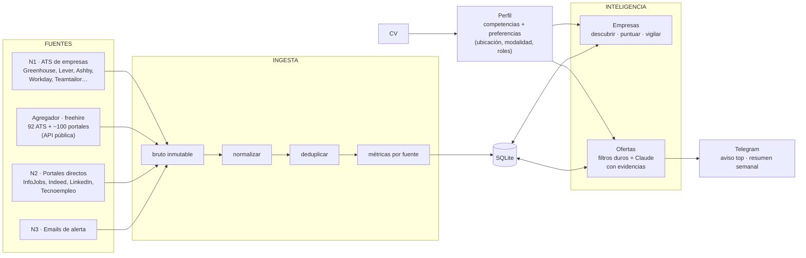
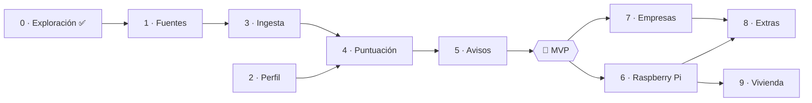

# job-radar: mapa del sistema, roadmap y herramientas

## Objetivo

Un radar personal de empleo **guiado por el CV**. A partir del CV y de las preferencias de la persona, encuentra las empresas y las ofertas que encajan con ella y avisa por Telegram solo de lo que merece la pena.

Todo lo que depende de la persona es **configuración del perfil**, no código:
- ubicaciones (p. ej. Málaga)
- modalidades (presencial, híbrido, remoto desde España, remoto con empresa extranjera)
- roles e idiomas
- umbrales de aviso

El primer usuario es Rubén: AI/LLM Engineer y agentes en producción, en Málaga o en remoto desde España. Si funciona, más adelante se convierte en producto. La vivienda es un **módulo secundario** que reutiliza la misma plataforma.

Principios:
1. **La calidad depende de las fuentes.** La ingesta es la parte más cuidada.
2. **Integrar, no crear.** Para cada bloque se usa una herramienta existente que haya pasado una prueba verificable. El código propio es solo el pegamento, más lo que no exista. Catálogo de candidatos: [`docs/repositorios.md`](repositorios.md).
3. **La empresa es la unidad principal**, no la oferta (ver `docs/estado-del-arte.md`).
4. **Poco a poco.** Cada fase termina con algo comprobable.

## Mapa global

Además, a lo largo de todo el sistema: planificador, salud de fuentes, tope de gasto en LLM y configuración.

### Matching a dos niveles
- **Empresa** (¿es una empresa para mí?): a qué se dedica, madurez en IA con evidencias, stack, presencia en las ubicaciones del perfil o remoto, momento de contratación. Se recalcula de forma mensual o cuando cambia el perfil. Decide qué empresas se vigilan y con qué frecuencia.
- **Oferta** (¿es este puesto para mí?):
  - Primero, filtros duros deterministas.
  - Después, Claude da veredictos por criterio con una cita de la oferta. Las restricciones duras (modalidad, idioma, seniority) se marcan como pasa / no pasa / no se sabe.
  - Python calcula el porcentaje y lo pondera con el encaje de la empresa.

### Niveles de fuente
| Nivel | Fuentes | Acceso |
|---|---|---|
| **1. Canónica** | ATS de empresas (Greenhouse, Lever, Ashby, Workable, SmartRecruiters, Recruitee, Teamtailor, Personio, Workday, SuccessFactors…), Himalayas, Manfred | Endpoints públicos sin clave |
| **Agregador** | [freehire](https://github.com/strelov1/freehire) (MIT): ~3M ofertas de 92 ATS y ~100 portales, deduplicadas y enriquecidas | API pública sin clave. Da amplitud (ATS de empresas de Málaga, remoto); las fuentes directas cubren lo que le falta o trae peor |
| **2. Portales** | InfoJobs (adaptador `infojobs_es` con httpcloak), Indeed y Glassdoor vía JobSpy, Tecnoempleo | Scraping a baja frecuencia y con búsquedas acotadas. InfoJobs: decisión de Rubén (15-oct-2026), uso personal |
| **3. Solo emails propios** | LinkedIn, Welcome to the Jungle, Wellfound | Alertas a un buzón dedicado |
| **APIs de terceros** | LinkedIn vía fantastic.jobs (RapidAPI) | Ellos hacen el scraping; nosotros consumimos cuota. Sin 429 ni riesgo para nuestra IP |
| **Excluidas** | LinkedIn con sesión, Google Jobs, auto-apply | Riesgo de cuenta, riesgo legal o sin datos |

Métricas por fuente en cada ejecución: rendimiento, completitud, precisión, exclusividad, estabilidad y riesgo.

## Roadmap

El seguimiento vivo está en GitHub: cada fase es un **milestone** y cada tarea un **issue** con sus criterios de aceptación y sus dependencias.

| # | Fase | Qué conseguimos | Criterios de aceptación | Herramientas a probar |
|---|---|---|---|---|
| 0 | Exploración ✅ | Datos reales de varias fuentes | `spikes/` con datos de 4 fuentes | — |
| 0b | Estado del arte ✅ | Saber qué existe | `docs/estado-del-arte.md` | — |
| **1** | **Fuentes** ← *en curso* | Saber de dónde salen las ofertas | Cada fuente candidata probada y marcada como ✅ o ❌. Lista de fuentes v1 cerrada. Campos comunes de una oferta definidos | ver tabla de abajo |
| 2 | Perfil | El CV convertido en perfil | Fichero de perfil (competencias con evidencia + preferencias) extraído con Claude y **aprobado por Rubén**. Ubicaciones y modalidades son configurables | Claude con salida estructurada (Pydantic); ESCO v1.2.1 + capa propia de skills de IA |
| 3 | Ingesta | Ofertas guardadas sin duplicados | Un comando llena SQLite con las fuentes v1 (bruto + normalizado). La misma oferta en dos fuentes cuenta una vez. Métricas por fuente. 7 días seguidos sin errores en el Mac | `sqlite-utils`; `tenacity`; EmbeddingGemma-300M (opcional, deduplicación) |
| 4 | Puntuación | Claude decide qué es top | 30 ofertas etiquetadas por Rubén. Claude coincide en al menos un 80 % (top / no top). Coste diario medido | Claude Haiku con rúbrica (referencias: career-ops, JobSync; JobOps solo lectura) |
| 5 | Avisos | Llega a Telegram | Aviso inmediato de lo top y resumen semanal, recibidos durante una semana | `python-telegram-bot` |
| 🎯 | **MVP** | **Radar útil de punta a punta** | | |
| 6 | Raspberry Pi | Funciona sola | 7 días en la Pi. Alerta si una fuente cae a 0 | timers de systemd o APScheduler; detección de anomalías de volumen |
| 7 | Empresas | Encaje a nivel empresa | Lista viva de empresas puntuadas. Las mejores se vigilan solas | PDF del PTA, Promálaga/Dealroom; detección de ATS (patrones + CDX de Common Crawl) |
| 8 | Extras | Bot, candidaturas, mercado | Por definir al llegar | — |
| 9 | Vivienda | Módulo secundario | Por definir al llegar | — |

## Fase 1 · Fuentes: pruebas

Estados: ⬜ por probar · 🟡 probada a medias · ✅ aprobada · ❌ descartada.

| Fuente | Herramienta | Prueba verificable | Estado |
|---|---|---|---|
| ATS de empresas | [`ats-scrapers`](https://github.com/kalil0321/ats-scrapers) 0.3.0 (MIT) con `beautifulsoup4`, `html2text` y `aiohttp` | Leer las ofertas de Ebury (Greenhouse EU), Freepik (Teamtailor) y Accenture Málaga (Workday) → `spikes/prueba_ats.py` | ✅ 15-oct-2026, detalle abajo |
| InfoJobs | Adaptador `infojobs_es` de ats-scrapers + `httpcloak`, con `listing_url` filtrado y `max_pages` bajo | Página 1 sin captcha, filtro respetado, descripción y modalidad rellenas → `spikes/prueba_infojobs.py` | ✅ 15-oct-2026, detalle abajo |
| Indeed y Glassdoor | [JobSpy](https://github.com/speedyapply/JobSpy) `python-jobspy==1.3.0` (MIT) | Ofertas de la ubicación con descripción y URL directa | 🟡 Indeed bien en el spike; Glassdoor sin probar |
| LinkedIn (búsqueda) | **API de LinkedIn de fantastic.jobs vía RapidAPI** (v4, `/active-jb`); plan B: JobSpy con pausas | Ofertas de Málaga y remoto con descripción → `spikes/prueba_linkedin_api.py` | ✅ 16-oct-2026, detalle abajo |
| **freehire (agregador)** | API pública `freehire.me/api/v1` (`/jobs/facets`, `/agent/jobs/search`) | Cobertura de Málaga y de remoto, fuentes, completitud → `spikes/prueba_freehire.py` | ✅ 16-oct-2026, detalle abajo |
| Remoto con elegibilidad | **API pública de [freehire](https://github.com/strelov1/freehire)** (agrega InfoJobs, Manfred, Get on Board, Himalayas, RemoteOK, Remotive…); adaptadores de ats-scrapers; API de Himalayas (`country=Spain`) | Ofertas remotas que admiten España, con descripción; medir cobertura y frescura frente a las fuentes directas | ⬜ |
| ATS europeos y detección | Adaptadores de [maccydee/job-radar](https://github.com/maccydee/job-radar) (Personio, Teamtailor, Recruitee, Workable) + su `discover` + dataset de 17.814 boards | Resolver el ATS de una lista corta de empresas de Málaga | ⬜ |
| Tecnoempleo | RSS (solo últimas 80) o búsqueda a baja frecuencia, **solo con código Python** (su robots.txt bloquea agentes LLM) | Ofertas filtradas por ubicación y tecnología | 🟡 RSS sin filtros en el spike |
| Emails de alerta (LinkedIn) | Por buscar: parsers existentes de alertas | Extraer ofertas de un email real | ⬜ |

**Detalle de ATS.**
- Ebury: 149 ofertas con descripción en menos de 1 s.
- Dos huecos que cubre una envoltura fina, y que son buenos candidatos a contribuir aguas arriba:
  - **Workday** no admite búsqueda: descarga todo el catálogo y en Accenture falla al pasar de 1.000. Con `searchText: "Malaga"` salen 32.
  - **Teamtailor** no admite dominio propio. Freepik: `jobs.magnific.com/jobs.rss`, 17 ofertas.
- ❌ El directorio `find_company` de ats-scrapers no es fiable ("ebury" → Middlebury College).
- ❌ [open-jobs-data](https://github.com/ConorsCode/open-jobs-data): lista fija de unas 380 empresas, casi todas de EE. UU., y sin descripciones.

**Detalle de InfoJobs.**
- Hay que filtrar con parámetros de búsqueda; las rutas semánticas (`/ofertas-trabajo/malaga`) caen en captcha. Parámetros: `provinceIds=34` (Málaga), `categoryIds=150` (Informática), `teleworkingIds=2` (solo teletrabajo), `keyword` y `sortBy=PUBLICATION_DATE`. Los códigos vienen en `aggregation` de la propia respuesta.
- Málaga + Informática son **50 ofertas en total**: 3 páginas cubren todo el mercado tech de Málaga en InfoJobs.
- Calidad:
  - 95–100 % con descripción y modalidad.
  - **~55 % con salario** (Indeed: 22 %).
  - Empresa siempre visible.
- `keyword=ia` mete ruido (Verisure, administrativos); es mejor filtrar por categoría y puntuar con Claude.
- Las tarjetas promocionadas se repiten en la página, así que hay que deduplicar por `code`.

**Detalle de freehire.**
- **Málaga: 748 ofertas abiertas.** Unas 230 vienen de ATS de empresas (Teamtailor 63, SmartRecruiters 48, Workday 42, Workable 41, Greenhouse 25, Personio 12). Es una mina para descubrir empresas de Málaga (Fase 7).
- **Remoto en España + IA: 772. Remoto en la UE + LLM: 382.** Cubre el remoto mucho mejor que cualquier fuente directa.
- Descripción completa en el 100 % de la muestra.
- Debilidades, que justifican mantener fuentes directas:
  - **Salario casi nunca** (0–5 %, frente al ~55 % de InfoJobs directo).
  - De InfoJobs solo tiene 35 ofertas de Málaga, frente a las 50 de nuestra búsqueda directa.
  - La mitad de Málaga viene de `whatjobs-es`, un agregador que repite ofertas (Tecdata, Grupo Digital).
  - El enriquecimiento es parcial (seniority 25–75 %, inglés 10–15 %).
  - El filtro `countries=es` + `remote` deja pasar algunas ofertas de fuera.
- **"Fantasma":** el 72 % de Málaga está marcado `stale`. Hay que entender qué significa antes de filtrar por ello.
- Vocabulario: `countries=es`, `cities=Málaga`, `regions=eu`, `work_mode=remote|hybrid|onsite`, `q` para texto. `is_tech=true` no filtra (devuelve 0).

**Detalle de LinkedIn (fantastic.jobs).**
- API v4 en RapidAPI: `GET /active-jb` con `time_frame` (1h, 24h, 7d, 6m), `title` y `location` con sintaxis tipo Google, `ai_work_arrangement`, `organization_agency`, `has_salary` y `description_format=text`.
- **Málaga + puestos técnicos, 7 días: 41 ofertas**, todas realmente en Málaga.
  - 100 % con descripción, modalidad (`ai_work_arrangement`), skills (`ai_key_skills`) y **ficha de empresa de LinkedIn** (sector, tamaño, web, sede): justo lo que necesita el nivel empresa.
  - Relevantes: *Python Developer – AI Agents, MCP & SDD* (Abalia) y *Technical Lead IA / AI Architect* (addSolutions).
- **España + remoto + IA, 7 días: 50 (tope de la llamada)**, con un 22 % con salario. Hay ruido de plataformas de "AI trainer" (Alignerr, Jobgether), que se filtra con `organization_agency=exclude`, `exclude_organization` y la puntuación con Claude.
- **Cuota del plan gratuito: 25 llamadas y 250 ofertas al mes.** La prueba gastó 3 llamadas y ~100 ofertas. Cubre una búsqueda semanal de Málaga, pero no un uso diario con remoto. Alternativas: el plan Pro de RapidAPI o el mismo proveedor en Apify (1,50 $ por cada 1.000 ofertas).
- La API hermana **Active Jobs DB** (mismo proveedor) cubre ATS y webs de empleo de empresas, con filtro por dominio y ficha de LinkedIn. Es una alternativa o complemento de freehire.
