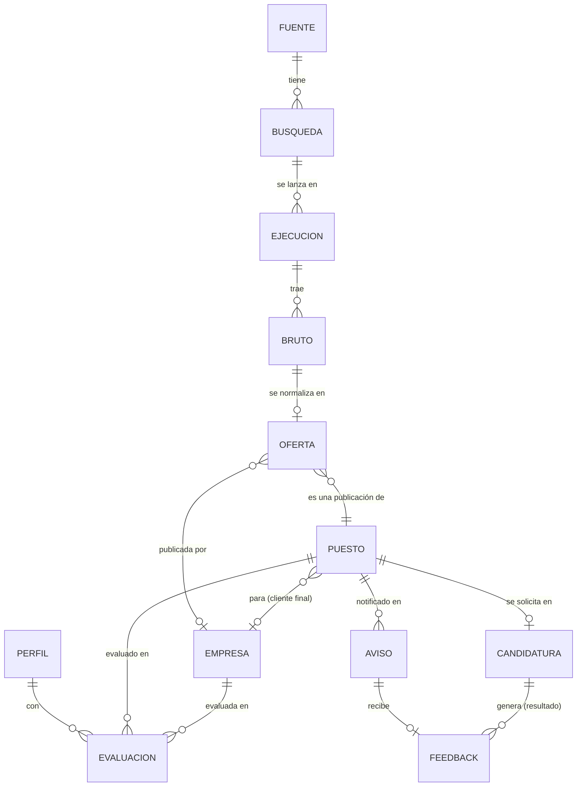

# Modelo de datos y conectores de fuentes

Las fuentes externas son la parte que menos controlamos: cambian de formato, cierran, nos limitan o suben de precio. Por eso el sistema las trata con tres garantías:

| Garantía | Qué significa | Cómo se consigue |
|---|---|---|
| **Trazable** | De cualquier dato que veas (una oferta en Telegram, un salario) se puede llegar a la respuesta original de la fuente, a la ejecución que la trajo y a la versión del adaptador que la interpretó | Bruto inmutable + `ejecucion_id` + `adaptador_version` en cada registro; procedencia por campo al fusionar |
| **Reemplazable** | Cambiar una fuente (p. ej. LinkedIn de RapidAPI a Apify) es escribir un adaptador nuevo, sin tocar nada más | Un contrato único por fuente; el resto del sistema solo conoce `Oferta` |
| **Monitorizable** | Si una fuente cae, cambia de formato en silencio o se queda sin cuota, nos enteramos ese mismo día | Cada ejecución registra métricas; comprobaciones de salud diarias con aviso por Telegram |

## Entidades

Implementación del esquema: [`src/job_radar/almacen.py`](../src/job_radar/almacen.py) (SQL explícito con migraciones numeradas).



| Entidad | Qué es | Campos clave |
|---|---|---|
| **Fuente** | Un origen externo de ofertas y el adaptador que lo lee | `id` (`freehire`, `infojobs`, `linkedin`, `indeed`, `ats`), tipo (agregador, portal, API de terceros, ATS), herramienta y versión, acceso (público, clave, scraping), coste, términos de uso, **plan B**, estado (activa, pausada, caída) |
| **Búsqueda** | Una consulta concreta a una fuente, derivada del perfil | fuente, parámetros (ubicación, modalidad, términos), frecuencia |
| **Ejecución** | Una vez que se lanzó una búsqueda | inicio y fin, estado, recibidos, nuevos, errores de normalización, cuota restante, coste, `adaptador_version` |
| **Bruto** | La respuesta original de la fuente, tal cual, **inmutable** | `ejecucion_id`, `id_externo`, payload JSON, hash, recibido en |
| **Oferta** | Una publicación normalizada de **una** fuente | campos comunes (abajo), `bruto_id`, vista por primera y última vez, abierta/cerrada |
| **Puesto** | **La vacante real**, que agrupa las ofertas que son lo mismo, aunque vengan de varias fuentes o de **varias consultoras** | título, empresa o cliente final si se sabe, ubicación, modalidad, ofertas, campos fusionados **con su procedencia** |
| **Empresa** | Una organización: empleadora o intermediaria | nombre y alias, dominio, slug de LinkedIn, sector, tamaño, sede, ¿consultora/agencia?, ATS (tipo + slug), señales de IA, estado de vigilancia (descubierta, evaluada, seguida, descartada) |
| **Perfil** | El candidato: competencias con evidencia + preferencias | versión, competencias, ubicaciones, modalidades, roles, idiomas, umbrales |
| **Evaluación** | El encaje de un puesto o una empresa con una versión del perfil | veredictos por criterio con cita, restricciones duras (pasa / no pasa / no se sabe), puntuación, modelo, coste |
| **Aviso** | Un mensaje enviado | puesto, canal, tipo (inmediato o resumen), enviado en |
| **Feedback** | Una señal de Rubén sobre un puesto: su reacción a un aviso o el resultado de una candidatura | origen (aviso o candidatura), 👍/👎 o resultado, motivo; alimenta la evaluación de la puntuación |
| **Candidatura** | Una solicitud a un puesto, gestionada desde la mesa de trabajo (`/apply`, `/outcome`) | puesto, fecha, material enviado (CV y carta), estado (enviada, entrevista, oferta, rechazo, sin respuesta), notas de entrevistas |

Decisiones:
- **Se avisa y se puntúa por Puesto, no por Oferta.** El mismo puesto de *Technical Lead Python – AI Agents* llegó por tres consultoras y tres portales: es un aviso, con las tres vías listadas.
- **Cómo se agrupan las ofertas en puestos** ([`puestos.py`](../src/job_radar/puestos.py)):
  - Solo se comparan ofertas de la misma zona: la misma ciudad, o remoto en el mismo país.
  - Siempre hace falta que los títulos sean compatibles: uno contiene al otro, quitando seniority y palabras vacías.
  - Con eso basta si es la misma empresa, o si la descripción es casi idéntica (reenvíos de agregadores).
  - Entre consultoras distintas, además, la descripción tiene que compartir los términos raros, pesados por rareza (IDF). Cada consultora reescribe el anuncio, así que la similitud de texto normal no sirve.
  - Con datos reales de Málaga, el *Technical Lead Python* sale como un solo puesto: 7 ofertas, 4 consultoras y 3 fuentes.
- **Al fusionar, cada campo recuerda de dónde viene.** Por ejemplo, el salario se toma por orden de preferencia (InfoJobs > LinkedIn > freehire > Indeed) y se guarda de qué oferta salió.
- **La mesa de trabajo (ai-job-search) no tiene datos propios:** lee el perfil y los puestos del SQLite y escribe ahí las candidaturas. Sus ficheros de perfil (`01-candidate-profile.md`…) se **generan** desde `perfil_cv.yaml`, nunca se editan a mano.
- **Las acciones largas son tareas en segundo plano** (cola huey sobre el mismo SQLite): preparar una candidatura o analizar skills devuelve una tarea cuyo estado y resultado se consultan desde la web.
- **La vivienda reutilizará Fuente, Búsqueda, Ejecución y Bruto** con su propia entidad (Anuncio).

## El conector: contrato de cada fuente

Cada fuente es un módulo con tres operaciones, y **nada más del sistema sabe cómo es la fuente por dentro**. Implementación: [`src/job_radar/fuentes/base.py`](../src/job_radar/fuentes/base.py).

```python
class Conector(Protocol):
    fuente: str                   # "linkedin"
    version: str                  # "linkedin-fantastic-rapidapi/1"
    personales: tuple[str, ...]   # campos que nunca se guardan
    cuota: dict | None            # lo que diga la fuente de su cuota en la última llamada

    def parametros(self, intencion: Intencion) -> list[dict]:
        """Lo que busca el candidato → el vocabulario de la fuente."""

    def traer(self, busqueda: Busqueda) -> Iterator[Bruto]:
        """Red. Pide a la fuente y devuelve las respuestas tal cual, sin datos personales. Puede fallar."""

    def normalizar(self, payload: dict) -> Oferta:
        """Pura, sin red. Convierte un bruto en Oferta. Determinista y testeable."""
```

De las preferencias a las búsquedas:
- Las preferencias se convierten en **intenciones**, independientes de cualquier fuente: una por ubicación presencial, con los términos principales y los amplios, y otra para remoto, solo con los principales.
- Cada conector traduce cada intención a sus parámetros (`provinceIds=34` en InfoJobs, `location="Malaga OR Málaga"` en LinkedIn…).
- Añadir una ciudad o un rol en `preferencias.yaml` cambia las búsquedas de todas las fuentes a la vez.

Por qué separar `traer` de `normalizar`:
- **Trazabilidad y reprocesado.** Si mejoramos la normalización, la volvemos a pasar sobre todo el bruto guardado, sin pedir nada otra vez a la fuente (ni gastar cuota).
- **Tests sin red.** Cada conector tiene *fixtures* con respuestas reales guardadas. Si la fuente cambia de formato, el test lo detecta en cuanto actualizamos la fixture.
- **Reemplazo limpio.** LinkedIn por RapidAPI y LinkedIn por Apify son dos conectores con la misma `fuente` y distinta `version`; se elige uno en la configuración.

Las fuentes, su conector activo, su coste, sus términos de uso, su frecuencia y su plan B se declaran en el **registro de fuentes** ([`config/fuentes.yaml`](../config/fuentes.yaml)):

| Fuente | Herramienta | Plan B |
|---|---|---|
| freehire | API pública `freehire.me/api/v1` | Active Jobs DB (fantastic.jobs); autoalojar freehire |
| infojobs | Adaptador `infojobs_es` de ats-scrapers + httpcloak | freehire (incluye InfoJobs, pero el 16-oct su copia iba 9 días por detrás); emails de alerta (#10) |
| linkedin | API de fantastic.jobs (RapidAPI o Apify) | El otro intermediario; JobSpy con pausas; emails de alerta |
| indeed | JobSpy | JSearch (RapidAPI) |
| ats | ats-scrapers (+ envolturas finas de Workday y Teamtailor) | Adaptadores de maccydee/job-radar; freehire |

## Monitorización

Cada ejecución deja sus métricas, y una comprobación diaria avisa por Telegram si:

| Señal | Qué detecta | Regla inicial |
|---|---|---|
| **No ha corrido** | El planificador o la Pi fallan | Ping a Healthchecks al terminar cada ejecución |
| **Volumen** | Fuente caída o bloqueada | Ofertas de 24 h por debajo del 30 % de la mediana de 7 días, o 0 |
| **Completitud por campo** | **Cambio de formato silencioso** (p. ej. la descripción llega vacía) | % de cada campo por debajo de su línea base |
| **Errores de normalización** | El conector ya no entiende la respuesta | Más de un 5 % de brutos sin normalizar |
| **Frescura** | La fuente devuelve ofertas viejas | La oferta más reciente tiene más de 3 días |
| **Cuota y coste** | Nos quedamos sin cuota o se dispara el gasto | Cuota restante < 20 %; coste mensual por encima del tope |
| **Exclusividad** | Una fuente deja de aportar | % de ofertas que solo trae ella (mensual; decide si sigue mereciendo la pena) |

El estado de cada fuente se consulta en un panel de Datasette sobre el SQLite.

## Campos comunes de una oferta

La `Oferta` normalizada, y de dónde sale cada campo en cada fuente. Nombres comprobados con datos reales el 16-oct-2026.

| Campo | freehire | InfoJobs (ats-scrapers) | LinkedIn (fantastic.jobs) | Indeed (JobSpy) | ATS (ats-scrapers) |
|---|---|---|---|---|---|
| `id_externo` | `public_slug` | `ats_id` | `id` (+ `linkedin_id`) | `id` | `ats_id` |
| `url` | `url` | `url` | `url` | `job_url_direct` o `job_url` | `url` / `apply_url` |
| `titulo` | `title` | `title` | `title` | `title` | `title` |
| `empresa` | `company` (+ `company_slug`) | `company` | `organization` (+ `org_linkedin_slug`) | `company` | `company` |
| `ubicacion` (ciudad, región, país) | `cities`, `countries`, `location` | `location`, `country_iso` | `cities_derived`, `regions_derived`, `countries_derived` | `location` | `location`, `country_iso` |
| `modalidad` (presencial, híbrido, remoto) | `work_mode` | `raw.modality` | `ai_work_arrangement` | `is_remote`, `work_from_home_type` | `is_remote` |
| `salario` (mín., máx., moneda, periodo) | `enrichment.salary_*` | `salary_min/max/currency/period` | `ai_salary_min/max_value`, `ai_salary_currency`, `ai_salary_unit_text` | `min_amount`, `max_amount`, `currency`, `interval` | `salary_*` |
| `descripcion` | `description` (`/agent/jobs/search`) | `description` | `description_text` | `description` | `description` |
| `publicada_en` | `posted_at` | `posted_at` | `date_posted` | `date_posted` | `posted_at` |
| `experiencia` / seniority | `enrichment.seniority`, `experience_years_min` | — | `ai_experience_level`, `seniority` | `job_level` | `experience` |
| `contrato` | `enrichment.employment_type` | `employment_type` | `ai_employment_type` | `job_type` | `employment_type` |
| `skills` | `skills` | — | `ai_key_skills` | (`skills`, casi nunca) | — |
| `ingles` | `enrichment.english_level` | — | — | — | — |
| `es_agencia` | — | — | `org_linkedin_recruitment_agency_derived` | — | — |
| ficha de empresa | `enrichment.company_size/type` | — | `org_linkedin_*` (sector, tamaño, web, sede) | `company_industry`, `company_num_employees` | — |
| estado / caducidad | `reality`, `closed_at` | — | `date_valid_through` | — | — |

Reglas de normalización:
- Lo que no trae la fuente queda **vacío**, nunca inventado. Los campos que infiere un modelo (los `ai_*` de fantastic.jobs, el `enrichment` de freehire) se marcan como **derivados**.
- **Datos personales fuera.** `emails` (JobSpy) y `ai_hiring_manager_name/email_address` (fantastic.jobs) se eliminan en `traer`, **antes** de guardar el bruto. El bruto es la respuesta original menos esos campos, y se anota cuáles se quitaron.
- Modalidad, moneda y periodo de salario, y contrato se reducen a **vocabularios cerrados** propios; el valor original queda en el bruto.
