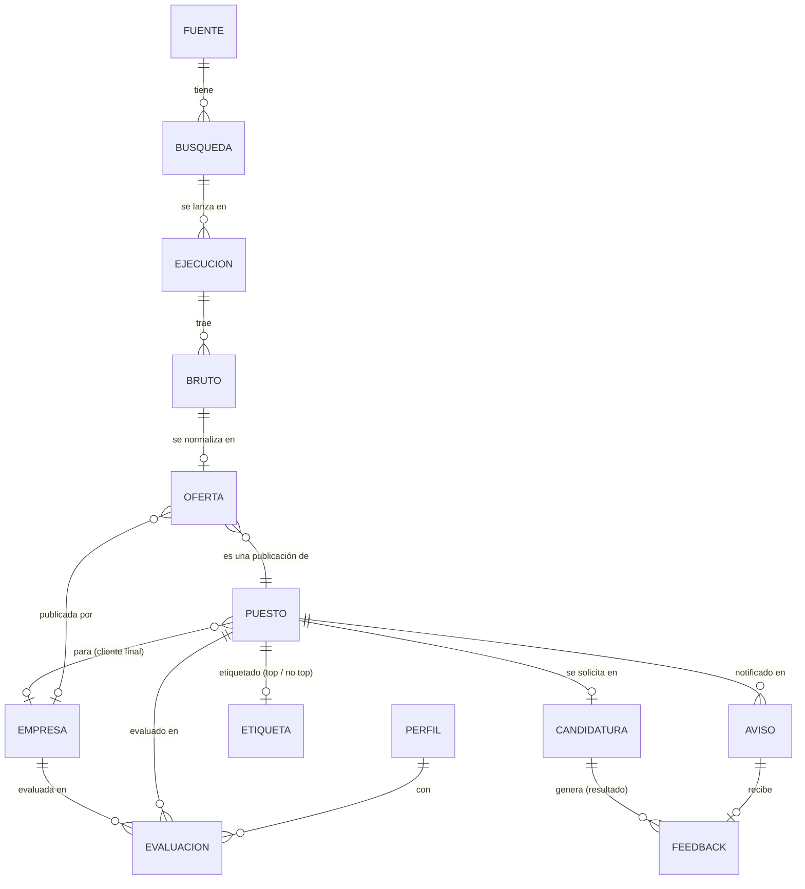

# Modelo de datos, conectores de fuentes, criba y puntuación

Las fuentes externas son la parte que menos controlamos: cambian de formato, cierran, nos limitan o suben de precio. Por eso el sistema las trata con tres garantías:

| Garantía | Qué significa | Cómo se consigue |
|---|---|---|
| **Trazable** | De cualquier dato que veas (una oferta en la web, un salario) se puede llegar a la respuesta original de la fuente, a la ejecución que la trajo y a la versión del adaptador que la interpretó | Bruto inmutable + `ejecucion_id` + `adaptador_version` en cada registro; procedencia por campo al fusionar |
| **Reemplazable** | Cambiar una fuente (p. ej. LinkedIn de RapidAPI a Apify) es escribir un adaptador nuevo, sin tocar nada más | Un contrato único por fuente; el resto del sistema solo conoce `Oferta` |
| **Monitorizable** | Si una fuente cae, cambia de formato en silencio o se queda sin cuota, nos enteramos ese mismo día | Cada ejecución registra métricas; comprobación de salud tras cada ingesta, y Healthchecks (opcional) avisa si falla o no corre |

## Entidades

Implementación del esquema: [`src/job_radar/almacen.py`](../src/job_radar/almacen.py) (SQL explícito con migraciones numeradas). Hoy existen las tablas de la ingesta, `etiqueta`, `evaluacion` y `ajuste`; Empresa se rellena en la Fase 7, y Aviso, Feedback y Candidatura llegarán con sus fases.



| Entidad | Qué es | Campos clave |
|---|---|---|
| **Fuente** | Un origen externo de ofertas y el adaptador que lo lee | `id` (`freehire`, `infojobs`, `linkedin`, `indeed`, `ats`), tipo (agregador, portal, API de terceros, ATS), herramienta y versión, acceso (público, clave, scraping), coste, términos de uso, **plan B**, estado (activa, pausada, caída) |
| **Búsqueda** | Una consulta concreta a una fuente, derivada del perfil | fuente, parámetros (ubicación, modalidad, términos), frecuencia |
| **Ejecución** | Una vez que se lanzó una búsqueda | inicio y fin, estado (en curso, ok, parcial, error), recibidos, nuevos, errores de normalización, completitud por campo, cuota restante, coste, `adaptador_version`, `ventana_h` (horas hacia atrás que pidió de verdad) |
| **Bruto** | La respuesta original de la fuente, tal cual, **inmutable** | `ejecucion_id`, `id_externo`, payload JSON, hash, recibido en |
| **Oferta** | Una publicación normalizada de **una** fuente | campos comunes (abajo), `bruto_id`, vista por primera y última vez, `valida_hasta` (hasta cuándo la da la fuente por abierta), `cerrada_en` |
| **Puesto** | **La vacante real**, que agrupa las ofertas que son lo mismo, aunque vengan de varias fuentes o de **varias consultoras** | título, empresa o cliente final si se sabe, ubicación, modalidad, ofertas, campos fusionados **con su procedencia**, estado (abierto, cerrado, fusionado en otro), `descarte` (motivo de la criba; vacío si pasa) |
| **Empresa** | Una organización: empleadora o intermediaria | nombre y alias, dominio, slug de LinkedIn, sector, tamaño, sede, ¿consultora/agencia?, ATS (tipo + slug), señales de IA, estado de vigilancia (descubierta, evaluada, seguida, descartada) |
| **Perfil** | El candidato: competencias con evidencia + preferencias | versión, competencias, ubicaciones, modalidades, roles, idiomas, salario actual y objetivo |
| **Etiqueta** | El juicio de Rubén sobre un puesto, desde la web: la vara de medir de la puntuación | top / no top, motivo; pasa al puesto que queda si dos se fusionan |
| **Evaluación** | El encaje de un puesto (y, en la Fase 7, de una empresa) con una versión del perfil | rúbrica (`rubrica/2`), huella del perfil, `texto_sha` (huella del texto puntuado), veredictos con cita y su verificación, nota, vetado y motivo, marcas, modelo, coste y tokens |
| **Aviso** | Un mensaje enviado (Fase 5, aparcada) | puesto, canal, tipo (inmediato o resumen), enviado en |
| **Feedback** | Futuro: el resultado de una candidatura (o la reacción a un aviso). Hoy la señal es la Etiqueta | origen (aviso o candidatura), resultado, motivo; alimenta la evaluación de la puntuación |
| **Candidatura** | Una solicitud a un puesto, gestionada desde la mesa de trabajo (`/apply`, `/outcome`) | puesto, fecha, material enviado (CV y carta), estado (enviada, entrevista, oferta, rechazo, sin respuesta), notas de entrevistas |
| **Ajuste** | Valores sueltos del sistema, clave → valor | p. ej. `visita_anterior` y `visita_actual`: lo «nuevo desde tu última visita» de la web (`POST /api/visita`; una visita nueva empieza tras 30 min sin actividad) |

Decisiones:
- **Se puntúa (y se avisará) por Puesto, no por Oferta.** El mismo puesto de *Technical Lead Python – AI Agents* llegó por tres consultoras y tres portales: es un puesto, con las tres vías listadas.
- **Cómo se agrupan las ofertas en puestos** ([`puestos.py`](../src/job_radar/puestos.py)):
  - Solo se comparan ofertas de la misma zona: la misma ciudad, o remoto en el mismo país. Una oferta sin modalidad (Indeed casi nunca la da) se compara también con las remotas de su país.
  - Siempre hace falta que los títulos sean compatibles: uno contiene al otro, quitando seniority, palabras vacías y el ruido (modalidad, ciudad, «m/f/d», códigos). Lo demás entre paréntesis sí cuenta: «(AI Training)».
  - Misma empresa y mismo título: basta. Misma empresa con títulos distintos: la descripción también tiene que parecerse (una empresa publica «Java Architect + AI» y «AI Architect»).
  - Descripción casi idéntica: basta (reenvíos de agregadores).
  - Entre consultoras distintas, además, la descripción tiene que compartir los términos raros, pesados por rareza (IDF). Cada consultora reescribe el anuncio, así que la similitud de texto normal no sirve.
  - Los grupos se unen por **enlace medio**, no por un único puente: dos grupos se juntan si al menos la mitad de sus pares casan, y primero las reglas fuertes (la misma oferta en varias fuentes antes que las consultoras).
  - Cada grupo conserva el puesto que ya tenía la mayoría de sus ofertas; si un grupo se parte, cada trozo tiene su propio puesto.
  - Con datos reales de Málaga, el *Technical Lead Python* sale como un solo puesto: 7 ofertas, 4 consultoras y 3 fuentes.
- **Ciclo de vida** (`puestos.cerrar`, en cada ingesta): una oferta se cierra si la fuente la da por caducada (`valida_hasta`: `date_valid_through` de LinkedIn, `closed_at` de freehire), o si se publicó hace más de 45 días y no se ha vuelto a ver en 14. Un puesto se cierra cuando lo están todas sus ofertas, y se reabre si alguna vuelve.
- **Al fusionar, cada campo recuerda de dónde viene.** Por ejemplo, el salario se toma por orden de preferencia (InfoJobs > LinkedIn > freehire > Indeed) y se guarda de qué oferta salió.
- **La mesa de trabajo (ai-job-search) no tiene datos propios:** lee el perfil y los puestos del SQLite y escribe ahí las candidaturas. Sus ficheros de perfil (`01-candidate-profile.md`…) se **generan** desde `perfil_cv.yaml`, nunca se editan a mano.
- **Las acciones largas serán tareas en segundo plano** (cola huey sobre el mismo SQLite, Fase 6, #41): preparar una candidatura o analizar skills devuelve una tarea cuyo estado y resultado se consultan desde la web.
- **La vivienda reutilizará Fuente, Búsqueda, Ejecución y Bruto** con su propia entidad (Anuncio).

## El conector: contrato de cada fuente

Cada fuente es un módulo con tres operaciones, y **nada más del sistema sabe cómo es la fuente por dentro**. Implementación: [`src/job_radar/fuentes/base.py`](../src/job_radar/fuentes/base.py).

```python
class Conector(Protocol):
    fuente: str                   # "linkedin"
    version: str                  # "linkedin-fantastic-apify/2"
    personales: tuple[str, ...]   # campos que nunca se guardan
    cuota: dict | None            # lo que diga la fuente de su cuota en la última llamada

    def parametros(self, intencion: Intencion) -> list[dict]:
        """Lo que busca el candidato → el vocabulario de la fuente."""

    def traer(self, busqueda: Busqueda) -> Iterator[Bruto]:
        """Red. Pide a la fuente y devuelve las respuestas tal cual, sin datos personales. Puede fallar."""

    def normalizar(self, payload: dict) -> Oferta:
        """Pura, sin red. Convierte un bruto en Oferta. Determinista y testeable."""
```

De las preferencias a las búsquedas:
- Las preferencias se convierten en **intenciones**, independientes de cualquier fuente: una por ubicación presencial, con los términos principales y los amplios, y otra para remoto, solo con los principales.
- Cada conector traduce cada intención a sus parámetros (`provinceIds=34` en InfoJobs, `location="Malaga OR Málaga"` en LinkedIn…).
- Añadir una ciudad o un rol en `preferencias.yaml` cambia las búsquedas de todas las fuentes a la vez. Si un conector no sabe traducir una ciudad (p. ej. el `provinceIds` de InfoJobs), lo anota en el log y no busca ahí, sin tumbar las demás fuentes.
- Los mercados en remoto (`remoto.mercados`, p. ej. AE, SA, QA) son intenciones remotas de otros países: solo las buscan las fuentes con `mercados: true` en el registro (hoy, freehire, que es gratis).

Por qué separar `traer` de `normalizar`:
- **Trazabilidad y reprocesado.** Si mejoramos la normalización, la volvemos a pasar sobre todo el bruto guardado (`job-radar renormalizar [--fuente X]`), sin pedir nada otra vez a la fuente (ni gastar cuota).
- **Tests sin red.** Cada conector tiene *fixtures* con respuestas reales guardadas. Si la fuente cambia de formato, el test lo detecta en cuanto actualizamos la fixture.
- **Reemplazo limpio.** LinkedIn por RapidAPI y LinkedIn por Apify son dos conectores con la misma `fuente` y distinta `version`; se elige uno en la configuración.

Las fuentes, su conector activo, su coste, sus términos de uso, su frecuencia y su plan B se declaran en el **registro de fuentes** ([`config/fuentes.yaml`](../config/fuentes.yaml)):

| Fuente | Herramienta | Plan B |
|---|---|---|
| freehire | API pública `freehire.me/api/v1` | Active Jobs DB (fantastic.jobs); autoalojar freehire |
| infojobs | Adaptador `infojobs_es` de ats-scrapers + httpcloak | freehire (incluye InfoJobs, pero el 16-oct su copia iba 9 días por detrás) |
| linkedin | API de fantastic.jobs en Apify (activo) | La misma API en RapidAPI (permite buscar por ID de LinkedIn); JobSpy con pausas |
| indeed | JobSpy | JSearch (RapidAPI) |
| ats | ats-scrapers (+ envolturas finas de Workday y Teamtailor), Fase 7 | Adaptadores de maccydee/job-radar; freehire |

Los emails de alerta se descartaron el 18-oct (#9, #10, los de LinkedIn): ataban el sistema a los filtros puestos a mano en el portal. Tampoco quedan como plan B de InfoJobs.

### Cómo corre la ingesta

`job-radar ingesta` ([`cli.py`](../src/job_radar/cli.py)) corre a diario con launchd en el Mac (8:30, con `--puntuar`):
- **Sin huecos.** Cada búsqueda pide desde su última ejecución buena (ok o parcial): como mínimo su frecuencia y como mucho 30 días. La ventana real queda en `ejecucion.ventana_h`. Una ejecución con error no cuenta, así que se repite en la siguiente.
- **Una a la vez.** Un cerrojo (`data/.ingesta.lock`) impide dos ingestas simultáneas; la segunda sale sin hacer nada.
- **Nada colgado.** Una ejecución que lleva más de 6 h «en curso» (Ctrl-C, proceso matado) pasa a error.
- **Una fuente caída no tumba las demás.** Su error queda en su ejecución.
- **Después de traer:** agrupar en puestos, cerrar lo caducado, cribar y, con `--puntuar`, puntuar lo nuevo.
- **Copias y logs.** Antes de cambiar nada, copia de la base en `data/copias/` (también con `job-radar copia`): una por día de los últimos 7 y la de cada lunes de las últimas 4 semanas. El log, `data/logs/ingesta.log`, rota cada día y guarda 30.
- SQLite en modo WAL con `busy_timeout` de 15 s: la web lee mientras la ingesta escribe.

## Monitorización

Cada ejecución deja sus métricas. Al final de cada ingesta, [`salud.py`](../src/job_radar/salud.py) las revisa; las alertas van al log, a la pantalla Fuentes de la web y, si `HEALTHCHECKS_URL` está en `.env` (opcional), a Healthchecks. La ingesta avisa a Healthchecks con `/start` al empezar y, tras puntuar, con «ok» o con `/fail` y las alertas; si no llega nada, Healthchecks avisa de que no ha corrido.

| Señal | Qué detecta | Regla inicial |
|---|---|---|
| **No ha corrido** | El planificador o la máquina fallan | Healthchecks (opcional), y cada fuente activa sin ejecución en 1,5 veces su frecuencia |
| **Error** | La fuente falla | La última ejecución de una búsqueda acabó en error |
| **Volumen** | Fuente caída o bloqueada | Recibidas por debajo del 30 % de la mediana de la búsqueda en los 7 días anteriores, o 0 |
| **Completitud por campo** | **Cambio de formato silencioso** (p. ej. la descripción llega vacía) | Un campo por debajo de la mitad de su línea base (si esta es de al menos un 20 %) |
| **Errores de normalización** | El conector ya no entiende la respuesta | Más de un 5 % de brutos sin normalizar |
| **Frescura** | La fuente devuelve ofertas viejas | La oferta más reciente tiene más de 3 días |
| **Cuota** | Nos quedamos sin cuota | Cuota restante < 20 % (el tope de gasto lo pone el conector: 4,8 $/mes en LinkedIn) |
| **Puntuación atascada** | `claude` sin sesión o sin cuota | Puestos que pasan la criba y llevan más de 36 h sin nota |
| **Exclusividad** | Una fuente deja de aportar | % de puestos que solo trae ella (en `job-radar resumen`; decide si sigue mereciendo la pena) |

Las reglas están en [`salud.py`](../src/job_radar/salud.py) (`uv run job-radar salud`). El estado de cada fuente, las ejecuciones, los puestos que llegan por varias vías y la traza de cualquier oferta hasta su bruto se consultan en Datasette con las consultas de [`config/datasette.yaml`](../config/datasette.yaml).

## Criba y puntuación

### Criba

Antes de puntuar, [`criba.py`](../src/job_radar/criba.py) descarta sin coste lo que no puede ser un puesto para el candidato. Son reglas deterministas, en este orden:

| Regla | Descarta | Configuración |
|---|---|---|
| **País** | Un puesto presencial o híbrido en un país que no es el de las ubicaciones (ni el de `remoto.desde_pais`). No descarta por país los remotos ni los que no tienen país: eso lo decide al puntuar la compuerta de modalidad o la de elegibilidad | `ubicaciones`, `remoto` |
| **Título excluido** | El título contiene un término excluido («sales», «ai training»…) | `roles.excluir` |
| **Título no técnico** | El título no tiene ninguna palabra técnica («Limpiador/a», «Electricista») | `roles.terminos`: principales, amplios y `tecnicos` (con `tecnicos` vacío no se aplica) |

Lo descartado no se borra: queda en `puesto.descarte` con su motivo y se ve en Puestos → Descartados. Un puesto etiquetado como top nunca se descarta. La criba se aplica en cada ingesta, y `job-radar cribar` la recalcula tras cambiar las preferencias.

### Puntuación

[`puntuacion.py`](../src/job_radar/puntuacion.py) aplica la rúbrica vigente, `rubrica/2` (18-oct-2026). Claude no da la nota: devuelve **veredictos con valores cerrados y una cita literal** de la oferta. Python comprueba las citas y calcula la nota con pesos fijos.

| Criterio | Valores (puntos) | Peso o efecto |
|---|---|---|
| **Compuertas**: modalidad, elegibilidad, idioma | pasa / no pasa / marca / sin datos | Un «no pasa» veta (nota 0) solo con cita verificada y sin duda en el motivo; si no, solo marca |
| **Rol de IA** | `ia_principal` (1) · `software_con_ia` (0,67) · `ml_clasico` (0,67) · `software_sin_ia` (0,33) · `ninguno` (0) | 40 %. Con `software_sin_ia` o `ninguno`, la nota no pasa de 45: se ven, pero no son top |
| **Requisitos** | Hasta 10, con importancia (crítico, alto, deseable), origen (dicho, inferido) y cobertura por el perfil (fuerte, parcial, falta) | 30 %: fracción cubierta de lo crítico (cuenta doble) y lo alto que pide la oferta; lo inferido nunca es crítico |
| **Función** | `ingenieria` (1) · `tecnica_adyacente` (0,5) · `no_construye_software` | 10 %. `no_construye_software` (entrenar modelos como experto, ventas, docencia…) veta |
| **Seniority** | `encaja` (1) · `reto` (0,6) · `por_debajo` (0,6) · `muy_por_encima` (0) | 10 % |
| **Fuente** | `directa` (1) · `intermediario` (0,6) · `dudosa` (0,2) | 10 % |
| **Salario** | Las cifras que da el texto, con su cita | Ver abajo |

- **Citas verificadas** (`cita_valida`): cada cita tiene que estar en el texto de la oferta, con las mismas cifras («55.000» no vale si el anuncio dice «35.000»). Una cita falsa no cuenta como evidencia, y se quita todo requisito «dicho» que no esté en la oferta.
- **El salario, en Python**, frente a `salario.actual` y `salario.objetivo` de las preferencias. Primero cuenta el dato real de la fuente; si no lo hay, el que el modelo citó del texto; y si tampoco, el que infirió la fuente, que es estimado si la cifra no está en el anuncio.
  - Un salario dicho por debajo del actual deja la nota en 45 como mucho; uno estimado por debajo resta 15.
  - Entre el actual y el objetivo, suma hasta 10 puntos.
  - Las tarifas por hora o por día solo se marcan.
- **Qué se puntúa** (`pendientes`): los puestos abiertos que pasan la criba y no tienen evaluación con esta rúbrica y esta huella del perfil. También se repuntúan los que cambian de texto (`texto_sha`; p. ej., otra descripción tras reagrupar). Van primero los más nuevos.
- **Motor**: `claude -p` con la suscripción (`ClaudeCLI` en [`llm.py`](../src/job_radar/llm.py), Sonnet por defecto), a diario tras la ingesta (`ingesta --puntuar`). `ANTHROPIC_API_KEY` no debe estar definida, porque `claude -p` cobraría por token (el conector la quita del entorno por si acaso). Falta decidir el motor dentro de Docker (#44).
- **`job-radar recalcular`** rehace la parte de Python (citas, vetos, salario y techos) con los veredictos guardados, sin llamar al modelo: cambiar el salario deseado o las reglas no cuesta nada.

### Medida

`job-radar medir` compara la última evaluación de cada puesto etiquetado con la etiqueta de Rubén. Da el acuerdo top / no top, el umbral elegido **dejando uno fuera** (la cifra honesta con pocas etiquetas) y el κ de Cohen. Con `rubrica/2`, el acuerdo es de ≈90 % y no se pierde ningún top. La web usa 50 como corte de «top» (pantallas Inicio y Puntuación).

## Campos comunes de una oferta

La `Oferta` normalizada, y de dónde sale cada campo en cada fuente. Nombres comprobados con datos reales el 16-oct-2026.

| Campo | freehire | InfoJobs (ats-scrapers) | LinkedIn (fantastic.jobs) | Indeed (JobSpy) | ATS (ats-scrapers) |
|---|---|---|---|---|---|
| `id_externo` | `public_slug` | `ats_id` | `id` (+ `linkedin_id`) | `id` | `ats_id` |
| `url` | `url` | `url` | `url` | `job_url_direct` o `job_url` | `url` / `apply_url` |
| `titulo` | `title` | `title` | `title` | `title` | `title` |
| `empresa` | `company` (+ `company_slug`) | `company` | `organization` (+ `org_linkedin_slug`) | `company` | `company` |
| `ubicacion` (ciudad, región, país) | `cities`, `countries`, `location` | `location`, `country_iso` | `cities_derived`, `regions_derived`, `countries_derived` | `location` | `location`, `country_iso` |
| `modalidad` (presencial, híbrido, remoto) | `work_mode` | `raw.modality` | `ai_work_arrangement` | `is_remote`, `work_from_home_type` | `is_remote` |
| `salario` (mín., máx., moneda, periodo) | `enrichment.salary_*` | `salary_min/max/currency/period` | `ai_salary_min/max_value`, `ai_salary_currency`, `ai_salary_unit_text` | `min_amount`, `max_amount`, `currency`, `interval` | `salary_*` |
| `descripcion` | `description` (`/agent/jobs/search`) | `description` | `description_text` | `description` | `description` |
| `publicada_en` | `posted_at` | `posted_at` | `date_posted` | `date_posted` | `posted_at` |
| `experiencia` / seniority | `enrichment.seniority`, `experience_years_min` | — | `ai_experience_level`, `seniority` | `job_level` | `experience` |
| `contrato` | `enrichment.employment_type` | `employment_type` | `ai_employment_type` | `job_type` | `employment_type` |
| `skills` | `skills` | — | `ai_key_skills` | (`skills`, casi nunca) | — |
| `ingles` | `enrichment.english_level` | — | — | — | — |
| `es_agencia` | — | — | `org_linkedin_recruitment_agency_derived` | — | — |
| ficha de empresa | `enrichment.company_size/type` | — | `org_linkedin_*` (sector, tamaño, web, sede) | `company_industry`, `company_num_employees` | — |
| estado / caducidad | `reality`, `closed_at` | — | `date_valid_through` | — | — |

Reglas de normalización:
- Lo que no trae la fuente queda **vacío**, nunca inventado. Los campos que infiere un modelo (los `ai_*` de fantastic.jobs, el `enrichment` de freehire) se marcan como **derivados**.
- **Datos personales fuera.** `emails` (JobSpy) y `ai_hiring_manager_name/email_address` (fantastic.jobs) se eliminan en `traer`, **antes** de guardar el bruto. El bruto es la respuesta original menos esos campos, y se anota cuáles se quitaron.
- Modalidad, moneda y periodo de salario, y contrato se reducen a **vocabularios cerrados** propios; el valor original queda en el bruto.
